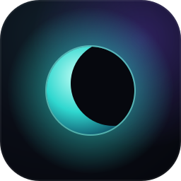
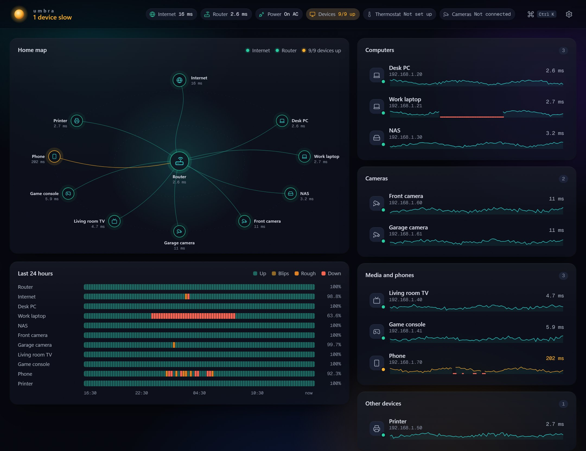
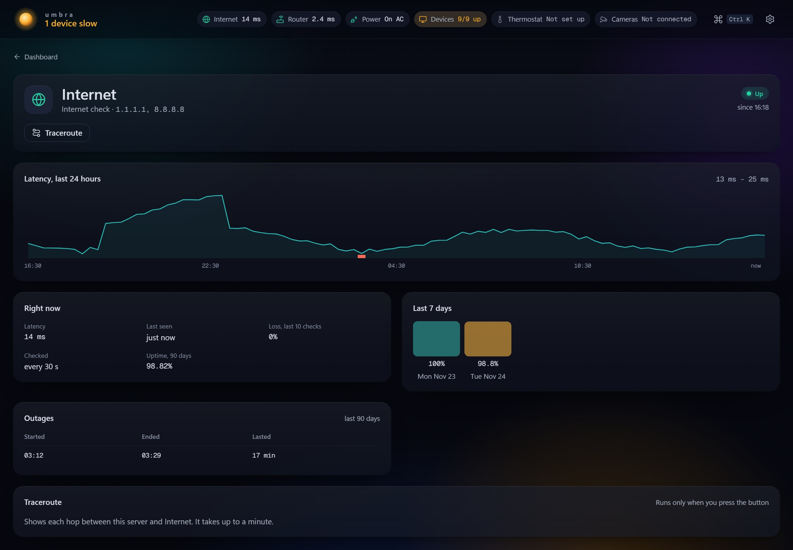
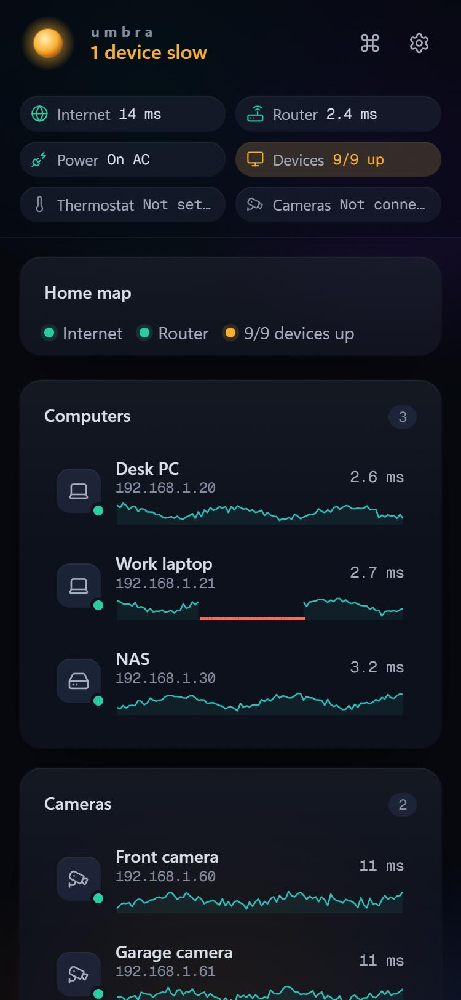
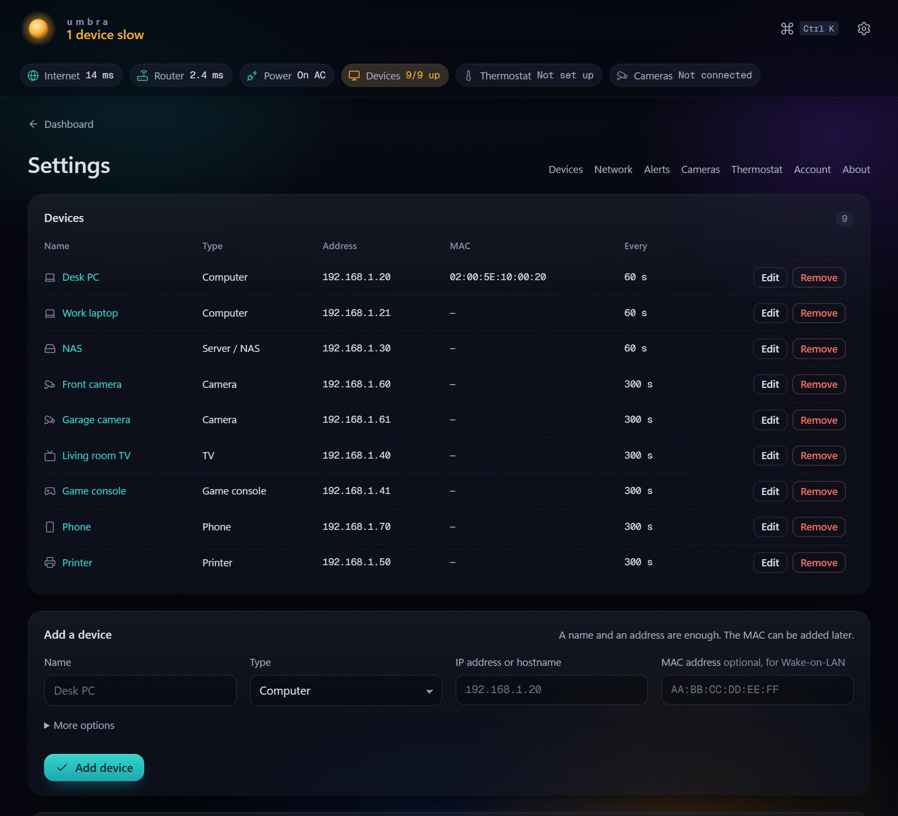

<p align="center">
  
</p>

<h1 align="center">Umbra</h1>

<p align="center">
  <b>A tiny, self-hosted status board for the devices in your home.</b><br>
  One Rust binary on an old laptop. Dark, calm, and light enough to forget it's running.
</p>

<p align="center">
  <a href="https://github.com/HighSkai/Umbra/releases/latest"></a>
  <a href="LICENSE"></a>
  
  
  
</p>

<p align="center">
  
  <br><sub>The dashboard, running <code>umbra demo</code> with simulated devices.</sub>
</p>

---

**Umbra** watches your router, your internet connection and everything on your home
network, and tells you in one glance whether all is well. It runs 24/7 on a spare
laptop, costs almost nothing while it does, and sends you a single message when
something actually changes. It's a status board, not a home-automation platform:
no automations, no plugins, no scripting.

## Highlights

- **Up, slow or down, at a glance.** Ping (and optional TCP) checks for every device,
  with latency, last seen, a 24-hour sparkline and an outage log. "Internet down",
  "Router down" and "Server offline" are told apart.
- **The eclipse orb.** The header orb is fully lit when everything is fine. When
  something breaks, a shadow slides across it in proportion and the glow shifts
  toward amber or red.
- **Home map.** Internet at the top, router in the middle, devices on an orbit, joined
  by thin curved links. A small pulse travels along a link each time a device is checked.
- **24-hour heatmap.** One row per device, one cell per 15 minutes. A bad night stands out.
- **Alerts that don't nag.** Phone push via [ntfy](https://ntfy.sh) and/or Discord, only
  when something changes. During an outage the alert is held and sent when the
  connection is back, folded into one "was down 14:02–14:20" message.
- **Power-outage detection.** When the server laptop drops to battery, you get "Power
  outage at home"; when power returns, "Power restored". Battery health, temperature,
  disk and uptime are shown too.
- **Front door.** Ring and Blink status (online, battery, Wi-Fi, last ding, last motion),
  Blink snapshots, and **live view on demand**.
- **Wake-on-LAN**, an **on-demand traceroute**, and a **command palette** (Ctrl+K).
- **Works on a phone.** Panels stack, the map becomes a summary, nothing scrolls sideways.

## Light by design

Measured over 10 idle minutes with 10 devices:

| | Budget | Measured |
|---|---|---|
| CPU at idle | < 0.5 % | **0.04 %** |
| Memory | < 20 MB | **~12 MB** (2.3 MB private) |
| First page load | < 150 KB gzipped | **~59 KB** |
| Binary | | **~4 MB**, one file |

One thread does all the work; check results are written to SQLite in one batch every
30 seconds; devices that are down back off exponentially; and the page only receives
live updates while a tab is visible. The UI is server-rendered HTML with
[htmx](https://htmx.org) and about 8 KB of hand-written JavaScript. No framework, no
build step, no CDN. `/debug/stats` shows these numbers live.

<table>
  <tr>
    <td width="62%"></td>
    <td width="38%" rowspan="2"></td>
  </tr>
  <tr>
    <td></td>
  </tr>
</table>

## Try it in 30 seconds

```bash
cargo build --release
./target/release/umbra demo      # then open http://127.0.0.1:8770
```

The demo invents a small household with 24 hours of history. It sends no packets and
no alerts, has no password, and only listens on 127.0.0.1.

## Install (Linux)

Any systemd-based distro works (Debian 12/13, Ubuntu Server 24.04, Fedora). A spare
laptop is ideal: its battery doubles as a UPS, which is what makes power-outage
alerts possible.

```bash
# Build tools and Rust (rustup is the official installer)
sudo apt install -y build-essential git curl
curl --proto '=https' --tlsv1.2 -sSf https://sh.rustup.rs | sh -s -- -y
source ~/.cargo/env

git clone https://github.com/HighSkai/Umbra.git
cd Umbra
cargo build --release
sudo ./packaging/install.sh
```

Then open `http://<server-ip>:8770` from any device on your home network.

`install.sh` installs the few packages Umbra uses (`python3-venv`, `curl`, `traceroute`,
`ffmpeg`), creates a locked-down `umbra` user, puts the binary in `/usr/local/bin`,
sets up `/etc/umbra/umbra.toml` and `/var/lib/umbra/`, seals a secrets key with
`systemd-creds`, installs the service, and asks you for the web password. Running it
again upgrades in place and keeps your settings, history and logins.

**Plug the server into the router with Ethernet if you can.** Over Wi-Fi it still
works, and Umbra reports "Server offline" rather than blaming your devices when its
own connection drops.

## Setup guide

<details>
<summary><b>Keep a laptop running with the lid closed</b></summary>

`install.sh` offers to do this. By hand:

```bash
sudo mkdir -p /etc/systemd/logind.conf.d
sudo tee /etc/systemd/logind.conf.d/umbra-lid.conf >/dev/null <<'EOF'
[Login]
HandleLidSwitch=ignore
HandleLidSwitchExternalPower=ignore
HandleLidSwitchDocked=ignore
IdleAction=ignore
EOF
sudo systemctl mask sleep.target suspend.target hibernate.target hybrid-sleep.target
sudo reboot
```

During a power outage the laptop runs on battery, which is exactly when it must not
suspend. If a desktop environment is installed, set its power settings to never suspend too.

Worth setting in the laptop's BIOS/UEFI if available:

- **A battery charge limit** (often called Battery Health Manager, Battery Care or
  Conservation mode, around 80 %). A battery kept at 100 % around the clock wears out
  quickly. Some laptops expose this to Linux as
  `/sys/class/power_supply/BAT0/charge_control_end_threshold`; `install.sh` tells you if yours does.
- **Power on when AC is detected**, so the laptop restarts by itself if a long outage
  drains the battery.

Umbra shows battery health (current versus design capacity) so you can watch it age.
</details>

<details>
<summary><b>Add your devices</b></summary>

**Settings → Add a device.** A name and an IP address (or hostname) are enough. A MAC
address is only needed for Wake-on-LAN and can be added later.

- Default check intervals: router and internet 30 s, computers 60 s, everything else
  5 minutes.
- **Down** after 3 missed checks in a row (6 for phones and tablets, which sleep their
  Wi-Fi). **Slow** above 150 ms or with sustained packet loss. All adjustable.
- **Give devices fixed IP addresses** (a DHCP reservation in your router's settings),
  or an address can move and Umbra ends up watching the wrong thing.
- **Router address:** `auto` follows the server's default gateway, which suits most homes.
- **Wake-on-LAN** needs the target on Ethernet with WoL enabled in its BIOS and network
  adapter settings.
- **TCP port check:** for devices that ignore ping but have an open port (SSH 22, SMB 445,
  a web UI).

Everything you set in the UI is saved to `/etc/umbra/umbra.toml`, which you can also
edit by hand (then `sudo systemctl restart umbra`).
</details>

<details>
<summary><b>Alerts to your phone and Discord</b></summary>

Alerts fire only on a change: a device goes down (after the confirmation checks) or
comes back, the internet or router drops, the power goes out or comes back. Nothing
repeats, and while the router or power is out, alerts for everything behind it are
held back, so you get one message instead of twenty.

- **Phone (ntfy):** install the ntfy app, subscribe to a long random topic name (on
  ntfy.sh anyone who knows the name can read it), enter the same topic under
  **Settings → Alerts**, save, and press **Send a test alert**. Self-hosted ntfy servers
  and access tokens work too.
- **Discord:** Server Settings → Integrations → Webhooks → New Webhook → Copy Webhook
  URL, then paste it into **Settings → Alerts**.

During a power or internet outage an alert can't leave the house. Umbra holds it and
sends it, with the original time, as soon as the connection is back. To get power alerts
*during* the outage, put your router on a small UPS.

The topic and webhook live in the secrets store, never in `umbra.toml`.
</details>

<details>
<summary><b>Ring and Blink cameras</b></summary>

Neither has an official API. Umbra uses the community libraries
[python-ring-doorbell](https://github.com/python-ring-doorbell/python-ring-doorbell) and
[blinkpy](https://github.com/fronzbot/blinkpy), the ones Home Assistant uses, so this part
can break when Ring or Blink change something.

**Settings → Cameras:** sign in with your email and password, then enter the code you're
sent. The password is used once to get a refresh token and is never stored.

| | Checked | What |
|---|---|---|
| Ring | every 15 min | online, battery, Wi-Fi, last ding, last motion |
| Blink | every 12 min | online, Wi-Fi, armed state, last motion |

These are cloud reads that don't wake battery cameras, and clips are never downloaded.
Each check is a short-lived Python process that exits in a few seconds; nothing Python
stays resident. A failing integration backs off and shows a banner such as
**"Ring: login expired, reconnect"**; click it and sign in again.

**Live view** starts only when you press Live and stops when you close it, hide the tab,
or after 10 minutes. Ring uses WebRTC with video going **straight from Ring to your
browser**. Blink's stream is repackaged by ffmpeg without re-encoding (`-c:v copy`).
Nothing is recorded. Blink cameras also have **Snapshot**, at most once a minute.

Known upstream issues (late 2026): new Blink sign-ins are sometimes refused by Blink's
front end ([blinkpy #1329](https://github.com/fronzbot/blinkpy/issues/1329)), and one report
of Ring's 2FA step looping ([home-assistant/core #193473](https://github.com/home-assistant/core/issues/193473)).
Existing logins keep working. To update the helper libraries later, change the versions
in `helpers/requirements.txt` and rerun `install.sh`.
</details>

<details>
<summary><b>Reaching it from outside the house</b></summary>

**Never forward a port to Umbra.** Use a VPN:

- **Tailscale:** install it on the server and your phone, then open
  `http://<server-tailscale-name>:8770`. Tailscale addresses are already allowed.
- **WireGuard:** add its subnet to `allow_cidrs` under `[server]` in `umbra.toml`.

Umbra refuses requests from public IP addresses however they arrive.
</details>

<details>
<summary><b>Troubleshooting</b></summary>

| Symptom | Fix |
|---|---|
| Every device shows down | `journalctl -u umbra -n 50`, and check the server has a network (`ip route`). |
| "Router down" but the internet works | Set the router's address in **Settings → Network**. |
| Alerts never arrive | **Send a test alert**; make sure `curl` is installed. Alerts wait while the internet is down. |
| "The Python helper environment isn't installed" | Rerun `sudo ./packaging/install.sh`. |
| Blink live view says it needs ffmpeg | `sudo apt install ffmpeg` |
| Forgot the password | `sudo -u umbra umbra set-password -c /etc/umbra/umbra.toml` |
| Phone can't reach the page | Same network? If a firewall is on: `sudo ufw allow from 192.168.0.0/16 to any port 8770` |

Logs: `journalctl -u umbra -f`
</details>

<details>
<summary><b>Upgrade or uninstall</b></summary>

```bash
git pull && cargo build --release && sudo ./packaging/install.sh   # upgrade
```

```bash
sudo systemctl disable --now umbra
sudo rm -rf /etc/systemd/system/umbra.service /etc/systemd/system/umbra.service.d \
  /usr/local/bin/umbra /opt/umbra /etc/credstore.encrypted/umbra-key
sudo systemctl daemon-reload
# your settings and history are in /etc/umbra and /var/lib/umbra
```
</details>

## Security

- Answers only to private, loopback, link-local, Tailscale and IPv6 ULA addresses (plus
  anything you add to `allow_cidrs`).
- One user and one password (argon2id). HttpOnly + SameSite=Strict session cookie, a CSRF
  token and same-origin check on every change, and a lockout after 5 wrong passwords.
- Secrets never touch the config file or the database. On Linux they're kept in an
  encrypted file whose key is sealed by `systemd-creds` to the machine's TPM or host key;
  on Windows (development) they're in Credential Manager.
- Python helpers get tokens on stdin, never on the command line or in the environment,
  and run in isolated mode with library logging silenced.
- The systemd unit runs as an unprivileged user with a read-only system and only
  `CAP_NET_RAW` (for ping on distros that disable unprivileged ping).
- Strict Content-Security-Policy and no telemetry. The only outbound traffic is your
  pings, Ring/Blink if you connect them, and your alert channel.

## Status and roadmap

Umbra **0.1** is new. The core monitoring, alerts, UI and demo are tested; the systemd
install path and the Ring/Blink integrations are fresh and haven't seen much real-world
use yet. Issues and reports are welcome.

Next up:

- **Thermostats over Matter.** Many recent smart thermostats are Matter-certified and can
  be read locally. The plan is a small controller inside the core
  ([rs-matter](https://github.com/project-chip/rs-matter)) rather than a separate server.
- Prebuilt Linux binaries on the releases page.

## Development

The same code builds and runs on Windows for development (ICMP via `IcmpSendEcho`, secrets
in Credential Manager). No Docker, WSL or Node.

```bash
cargo test
cargo run --release -- demo
cargo check --target x86_64-unknown-linux-gnu --no-default-features   # type-check the Linux paths
```

```
src/            Rust core: scheduler, checks, SQLite, alerts, power, demo
  web/          routes, login/CSRF, live updates (SSE), server-rendered SVG
templates/      askama HTML templates (compiled into the binary)
web/            CSS (tokens.css holds every color and size), JS, icons, font
helpers/        Python helpers for Ring and Blink, with pinned requirements
packaging/      install.sh and the systemd unit
```

## License

[MIT](LICENSE). Bundled: [htmx](https://htmx.org) (0BSD), [Lucide](https://lucide.dev)
icons (ISC) and [Geist Mono](https://vercel.com/font) (SIL OFL 1.1); see
[THIRD-PARTY-NOTICES.md](THIRD-PARTY-NOTICES.md).
